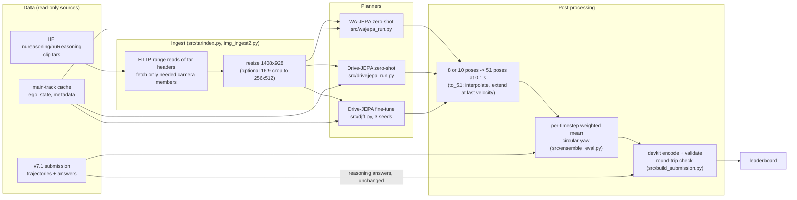
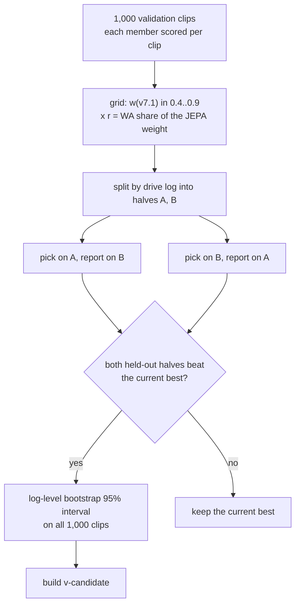
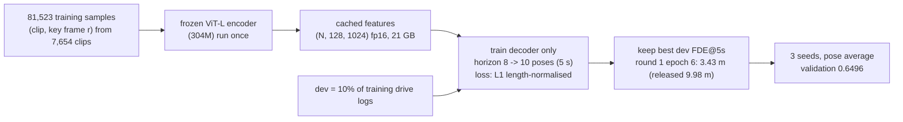

# nuReasoning planning: JEPA planners to a fine-tuned Alpamayo 2 Edge pool

Planning track of our entry to the **nuReasoning Challenge 2026** (Motional + UCLA; closed
2026-11-18, results at NeurIPS 2026). The task: from a nuReasoning clip (cameras, ego history,
route), output a 5 s ego trajectory (51 poses) and answer reasoning questions about the scene. This repo
is the planning side; the reasoning answers and the combined entry are in the companion repo
[amanupg/nureasoning-reasoning-2026](https://github.com/amanupg/nureasoning-reasoning-2026).

This is a public snapshot (one commit, 2026-11-21) of the private working repository. Not included:
the measurement ledger and working notes (code comments that cite `LEDGER` or `notes/` refer to them),
model outputs and submission files, data and weights. Numbers below come from that ledger.

Sibling projects from the same period (NVIDIA AlpaSim challenge):
[amanupg/alpasim-challenge-2026](https://github.com/amanupg/alpasim-challenge-2026) and
[amanupg/alpasim-jepa-2026](https://github.com/amanupg/alpasim-jepa-2026).

Score: `final = 0.75 x planning (NPS) + 0.25 x reasoning`. Planning NPS =
collision x drivable-area x (0.3 progress + 0.2 comfort + 0.5 human-likeness).

## Final result (challenge closed 2026-11-18)

| | final | planning | reasoning |
|---|---|---|---|
| **our entry v14.4** (team Aman_upg) | **0.8097** | **0.8169** | 0.7880 |
| rank on the frozen public board | **7th of 58** | | |
| 1st place (MARS Lab) | 0.8312 | 0.8292 | 0.8373 |
| organiser baseline | 0.6952 | 0.7294 | 0.5923 |

Frozen board: `notes/board_final_2026-11-21.tsv`.

**What the planning model is.** The final trajectories are a pool of four full fine-tunes of NVIDIA
Alpamayo 2 Edge (2.65B parameters, open weights released 2026-11-10), 16 flow-matching samples each,
averaged pointwise (circular mean for yaw). The members differ in training run and checkpoint (single
GPU epochs 1 and 2, and a 2-epoch data-parallel run on 4x H200 sampled with and without generated
decision text). Validation NPS 0.7493, +0.0074 [+0.0030, +0.0118] over the best single member;
test planning 0.8169.

How we got there (test planning): main-track chooser v7.1 0.7136 -> blend with zero-shot and
fine-tuned JEPA planners (WA-JEPA, Drive-JEPA) 0.7666 (v9.3) -> single Alpamayo 2 Edge fine-tune
0.8091 -> four-model pool 0.8169. The JEPA stage is documented below as it was built (October 2026).

## Models

| model | source / license | trained on | inputs we feed | output |
|---|---|---|---|---|
| WA-JEPA | AFARI-Research, HF `AFARI-Research/WA-JEPA`, Apache-2.0 | V-JEPA 2.1 (MIT) -> nuPlan video -> NAVSIM | 4 cameras (CAM_M_L0/F/R0/B) x 4 frames at 2 Hz, 256x512 (16:9 centre crop); ego status [cmd(4), vx, vy, ax, ay]; 4 history poses | 8 poses to 4 s (flow matching, 4 steps) |
| Drive-JEPA (perception-free) | linhanwang, code Apache-2.0, weights CC0 | V-JEPA ViT-L on driving video -> NAVSIM | front camera, one frame (repeated as a 2-frame clip), 512x256; status (8) | 8 poses (10 after our fine-tune) |

Both transfer because NAVSIM is built on nuPlan (Motional, 4 cities, sibling camera rig) and its
PDMS metric is a close relative of NPS. Rules check (challenge page, dataset card, all licenses):
"Pretraining on other public datasets and using public foundation models is permitted"; nuPlan
logs predate 2022 and nuReasoning logs are 2023-2026, so no overlap.

## Pipeline

## Choosing ensemble weights without overfitting validation

## Drive-JEPA fine-tune

Round 2 (12-epoch schedule, weight decay 1e-2, dropout 0.1) did not improve single seeds; averaging
three seeds did (+0.009).

## Experiments that did not help (kept for the record)

- **Drive-JEPA in the ensemble without fine-tuning:** never beats v7.1 above a 10% weight.
- **Maneuver hint for Decision questions** (`src/hint_check.py`): adding planner trajectories to the
  main track's reasoning models lowered accuracy (WA-JEPA -0.017); even the recorded future adds only
  ~+0.002 final. JEPA helps planning, not reasoning.
- **Sensor-sync shift** (pair poses with images one frame earlier): WA-JEPA validation -0.012
  [-0.021, -0.004]; kept the original pairing.
- **AD-E2E-JEPA, Auto-JEPA:** no released weights yet (checked 2026-09-30).

## Layout

| path | contents |
|---|---|
| `src/` | JEPA adapters and fine-tune, Alpamayo 2 Edge inputs / training (`edge_train.py`) / inference (`edge_infer.py`), ensemble search, submission builder, checks |
| `tools/` | pooling (`pool_test.py`), aggregation and paired-bootstrap helpers |
| `cluster/` | Slurm scripts (Columbia Insomnia cluster) and RunPod helpers; paths shown as `/path/to/...` |
| `notes/` | frozen final leaderboard |
| ignored | `.venv/`, `data/` (frames, caches), `weights/`, `ext/` (upstream clones: WA-JEPA @ bec2966, Drive-JEPA @ 548bb82), `logs/`, submission JSONs |

Reproduce a zero-shot run: `python src/wajepa_run.py --split validation --crop 169 --score`
(needs the devkit on `PYTHONPATH`, weights in `weights/`, frames from `src/img_ingest2.py`).

## Licence

Our code is MIT (see `LICENSE`), except the DriveMA prompt builders in `src/drivema_run.py` (Apache-2.0).

## Third-party code and weights

Weights and upstream code are not in this repo; each keeps its own licence.
- NVIDIA Alpamayo 2 Edge (`nvidia/Alpamayo2-Edge`, OpenMDW-1.1; code `NVlabs/alpamayo2-edge`).
- WA-JEPA (AFARI-Research, Apache-2.0) on V-JEPA 2.1 (MIT); Drive-JEPA (code Apache-2.0, weights CC0).
- DriveMA (Tsinghua-MARS-Lab/DriveMA, Apache-2.0): `src/drivema_run.py` contains its prompt builders, copied unchanged.
- py123d_garage (kesai-labs, Apache-2.0; checkpoints CC BY-NC-SA 4.0), used by `src/garage_ft.py`.
- nuReasoning devkit and data (challenge organisers), used under the challenge terms; not redistributed.
